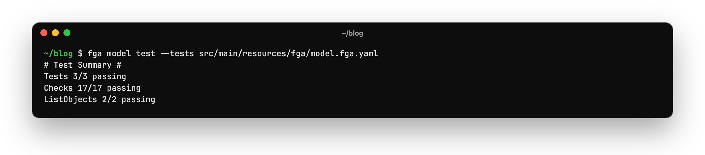
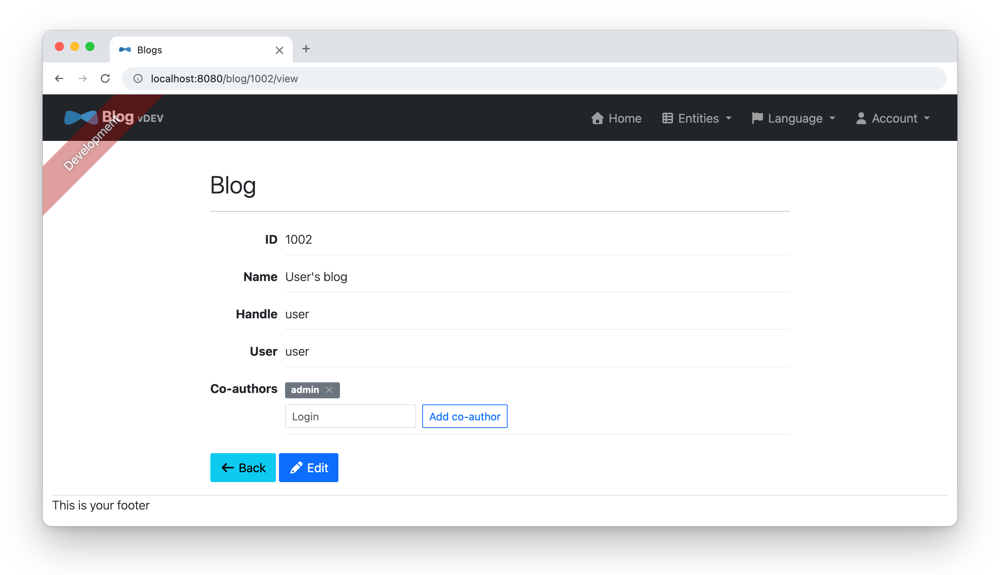
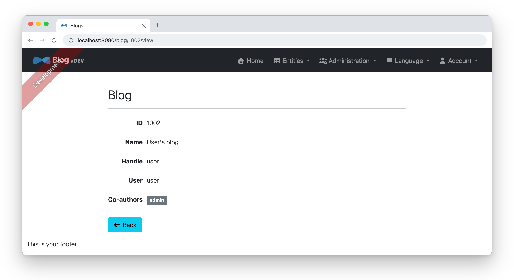
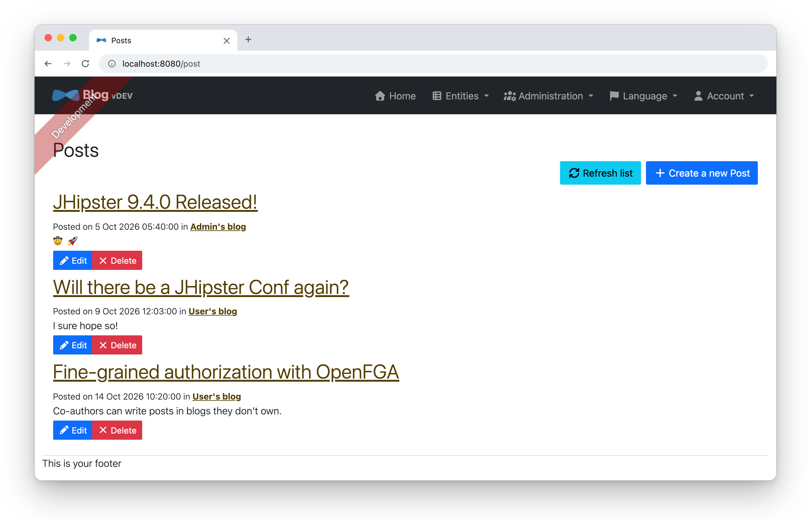

= Lock Down JHipster 9 with OpenFGA
:author: Matt Raible
:email:  matt@raibledesigns.com
:revnumber: 1.0
:revdate: {docdate}
:subject: JHipster
:keywords: JHipster, Spring Boot, Angular, OpenFGA, Authorization, Fine-Grained Authorization
:icons: font
:lang: en
:language: javascript
:sourcedir: .
ifndef::env-github[]
:icons: font
endif::[]
ifdef::env-github,env-browser[]
:toc: preamble
:toclevels: 2
endif::[]
ifdef::env-github[]
:status:
:outfilesuffix: .adoc
:!toc-title:
:caution-caption: :fire:
:important-caption: :exclamation:
:note-caption: :paperclip:
:tip-caption: :bulb:
:warning-caption: :warning:
endif::[]
:toc:

In the link:README.adoc#lock-it-down[Lock It Down!] section of the main tutorial, you added `if` statements to `BlogResource` and `PostResource` so only the owner of a blog can view and change it. That works, but every rule lives in Java code. Who can see what is spread across ten methods, and adding a new rule, like letting a friend write posts in your blog, means touching all of them again.

This tutorial replaces those checks with https://openfga.dev[OpenFGA], an open source, fine-grained authorization system inspired by https://research.google/pubs/zanzibar-googles-consistent-global-authorization-system/[Google's Zanzibar paper]. You describe your rules in an authorization model, store relationships (called _tuples_) like "`user:matt is the owner of blog:1`" in OpenFGA, and ask it questions like "`can user:matt edit post:7?`" Then, you'll add a feature that shows why this is worth it: co-authors who can write posts in a blog they don't own.

.Source Code
****
The finished code is in the https://github.com/mraible/jhipster9-demo/tree/openfga[`openfga` branch] of the https://github.com/mraible/jhipster9-demo[jhipster9-demo repository]. Each section below is one commit, and you can see all the changes in the https://github.com/mraible/jhipster9-demo/compare/main...openfga[comparison with `main`].
****

== Prerequisites

* The blog app from the link:README.adoc[Get Started with JHipster 9] tutorial, through the link:README.adoc#fix-integration-tests[Fix Integration Tests] section. You can also clone the `main` branch of https://github.com/mraible/jhipster9-demo[jhipster9-demo].
* https://docs.docker.com/get-docker/[Docker], to run OpenFGA and the integration tests.
* The https://openfga.dev/docs/getting-started/cli[OpenFGA CLI] (optional). On macOS, you can install it with `brew install openfga/tap/fga`. If you don't want to install it, you can run it with Docker as shown below.

== Run OpenFGA with Docker Compose

Create a Docker Compose file for OpenFGA next to the other files JHipster generated in `src/main/docker`. OpenFGA listens on port 8080 by default, which is the same as your app, so map it to 8090.

[source,yaml]
.src/main/docker/openfga.yml
----
# This configuration is intended for development purpose, it's **your** responsibility to harden it for production
name: blog
services:
  openfga:
    image: openfga/openfga:v1.22.0
    command: run
    # The default in-memory datastore loses all tuples when the container stops
    ports:
      - 127.0.0.1:8090:8080
    healthcheck:
      test: ['CMD', '/usr/local/bin/grpc_health_probe', '-addr=openfga:8081']
      interval: 5s
      timeout: 5s
      retries: 10
----

Then, add it to `src/main/docker/services.yml`, so `npm run services:up` (which the generated CI workflow uses) starts it with PostgreSQL.

[source,yaml]
.src/main/docker/services.yml
----
# This configuration is intended for development purpose, it's **your** responsibility to harden it for production
name: blog
services:
  postgresql:
    extends:
      file: ./postgresql.yml
      service: postgresql
    profiles:
      - ''
      - prod
  openfga:
    extends:
      file: ./openfga.yml
      service: openfga
----

Start it:

----
docker compose -f src/main/docker/openfga.yml up -d
----

WARNING: This uses OpenFGA's default in-memory datastore, which is fine for development. All tuples are lost when the container stops. In production, run OpenFGA with its https://openfga.dev/docs/getting-started/setup-openfga/configure-openfga[PostgreSQL or MySQL datastore].

== Define the Authorization Model

An OpenFGA authorization model defines types, the relations they have, and how relations imply each other. Create `src/main/resources/fga/model.fga` with the rules from the main tutorial: a blog has an owner, the owner can view and edit it, and a post inherits its permissions from its parent blog.

[source]
.src/main/resources/fga/model.fga
----
model
  schema 1.1

type user

type blog
  relations
    define owner: [user]
    define viewer: owner
    define editor: owner

type post
  relations
    define parent: [blog]
    define viewer: viewer from parent
    define editor: editor from parent
----

The nice thing about a model is you can test it before writing any Java code. Create `src/main/resources/fga/model.fga.yaml` with some tuples and the answers you expect.

[source,yaml]
.src/main/resources/fga/model.fga.yaml
----
name: blog
model_file: ./model.fga
tuples:
  - user: user:admin
    relation: owner
    object: blog:1
  - user: user:user
    relation: owner
    object: blog:2
  - user: blog:1
    relation: parent
    object: post:10
  - user: blog:2
    relation: parent
    object: post:20
tests:
  - name: owners can view and edit their own blogs and posts
    check:
      - user: user:admin
        object: blog:1
        assertions:
          viewer: true
          editor: true
      - user: user:user
        object: post:20
        assertions:
          viewer: true
          editor: true
  - name: users can't see each other's blogs or posts
    check:
      - user: user:user
        object: blog:1
        assertions:
          viewer: false
          editor: false
      - user: user:admin
        object: post:20
        assertions:
          viewer: false
          editor: false
    list_objects:
      - user: user:user
        type: post
        assertions:
          viewer:
            - post:20
----

Run the tests with the OpenFGA CLI:

----
fga model test --tests src/main/resources/fga/model.fga.yaml
----

Or, use Docker:

----
docker run --rm -v "$PWD":/work -w /work openfga/cli:v0.8.1 \
  model test --tests src/main/resources/fga/model.fga.yaml
----

The API expects the model as JSON, so convert it with `fga model transform`:

----
fga model transform --file src/main/resources/fga/model.fga > src/main/resources/fga/model.json
----

== Add the OpenFGA Spring Boot Starter

Add the https://github.com/openfga/spring-boot-starter[OpenFGA Spring Boot starter] to your `pom.xml`.

[source,xml]
.pom.xml
----
        <dependency>
            <groupId>dev.openfga</groupId>
            <artifactId>openfga-spring-boot-starter</artifactId>
            <version>0.4.1</version>
        </dependency>
----

NOTE: Version 0.4.1 is built for Spring Boot 3 and Jackson 2. It works with Spring Boot 4.1, but it adds Jackson 2 to your classpath next to Spring Boot's Jackson 3. A Spring Boot 4 version is in progress in https://github.com/openfga/spring-boot-starter/pull/201[openfga/spring-boot-starter#201].

Then, tell it where OpenFGA is in `src/main/resources/config/application.yml`.

[source,yaml]
----
openfga:
  api-url: http://localhost:8090
----

The starter creates an `OpenFgaClient` bean and an `fga` bean you can use in Spring Security expressions. However, it needs a store and an authorization model to exist first. The starter can write a model on startup, but only into a store that already exists, and an in-memory OpenFGA starts with no stores. Add a configuration class that finds or creates a `blog` store and writes the model when the app starts.

[source,java]
.src/main/java/org/jhipster/blog/config/OpenFgaConfiguration.java
----
package org.jhipster.blog.config;

import com.fasterxml.jackson.databind.ObjectMapper;
import dev.openfga.sdk.api.client.OpenFgaClient;
import dev.openfga.sdk.api.model.CreateStoreRequest;
import dev.openfga.sdk.api.model.Store;
import dev.openfga.sdk.api.model.WriteAuthorizationModelRequest;
import org.slf4j.Logger;
import org.slf4j.LoggerFactory;
import org.springframework.beans.factory.annotation.Value;
import org.springframework.boot.ApplicationRunner;
import org.springframework.context.annotation.Bean;
import org.springframework.context.annotation.Configuration;
import org.springframework.core.io.Resource;

/**
 * Creates the OpenFGA store (if needed) and writes the authorization model from {@code fga/model.json} on startup.
 */
@Configuration
public class OpenFgaConfiguration {

    private static final Logger LOG = LoggerFactory.getLogger(OpenFgaConfiguration.class);
    private static final String STORE_NAME = "blog";

    @Bean
    public ApplicationRunner openFgaInitializer(OpenFgaClient fgaClient, @Value("classpath:fga/model.json") Resource model) {
        return args -> {
            String storeId = fgaClient
                .listStores()
                .get()
                .getStores()
                .stream()
                .filter(store -> STORE_NAME.equals(store.getName()))
                .map(Store::getId)
                .findFirst()
                .orElse(null);
            if (storeId == null) {
                storeId = fgaClient.createStore(new CreateStoreRequest().name(STORE_NAME)).get().getId();
            }
            fgaClient.setStoreId(storeId);
            var request = new ObjectMapper().readValue(model.getInputStream(), WriteAuthorizationModelRequest.class);
            String modelId = fgaClient.writeAuthorizationModel(request).get().getAuthorizationModelId();
            fgaClient.setAuthorizationModelId(modelId);
            LOG.info("Using OpenFGA store {} with authorization model {}", storeId, modelId);
        };
    }
}
----

TIP: In production, you'd create the store and model ahead of time (for example, with `fga store create --model model.fga` in your deployment pipeline) and set `openfga.store-id` and `openfga.authorization-model-id` instead.

You'll also need to write and delete tuples when blogs and posts change. Create a small `FgaTuples` class for that.

[source,java]
.src/main/java/org/jhipster/blog/security/FgaTuples.java
----
package org.jhipster.blog.security;

import dev.openfga.OpenFgaExceptionHandler;
import dev.openfga.sdk.api.client.OpenFgaClient;
import dev.openfga.sdk.api.client.model.ClientTupleKey;
import dev.openfga.sdk.api.client.model.ClientTupleKeyWithoutCondition;
import java.util.List;
import org.springframework.stereotype.Component;

/**
 * Writes and deletes the relationship tuples that OpenFGA uses to decide who can access blogs and posts.
 */
@Component
public class FgaTuples {

    private final OpenFgaClient fgaClient;
    private final OpenFgaExceptionHandler exceptionHandler;

    public FgaTuples(OpenFgaClient fgaClient, OpenFgaExceptionHandler exceptionHandler) {
        this.fgaClient = fgaClient;
        this.exceptionHandler = exceptionHandler;
    }

    public void write(String user, String relation, String object) {
        try {
            fgaClient.writeTuples(List.of(new ClientTupleKey().user(user).relation(relation)._object(object))).get();
        } catch (Exception e) {
            throw exceptionHandler.handle(e, "Error writing tuple %s %s %s", user, relation, object);
        }
    }

    public void delete(String user, String relation, String object) {
        try {
            fgaClient.deleteTuples(List.of(new ClientTupleKeyWithoutCondition().user(user).relation(relation)._object(object))).get();
        } catch (Exception e) {
            throw exceptionHandler.handle(e, "Error deleting tuple %s %s %s", user, relation, object);
        }
    }
}
----

== Replace the Ownership Checks

Now for the fun part. JHipster already enables method security (`@EnableMethodSecurity` in `SecurityConfiguration`), so you can replace each hand-written check with a `@PreAuthorize` annotation that calls `@fga.check(objectType, objectId, relation, userType, userId)`. When a blog is created, write a tuple that makes the current user its owner. When it's deleted, remove the tuple, but only after the database delete is flushed. If the delete fails (for example, because the blog still has posts), the owner keeps access.

[source,diff]
----
diff --git a/src/main/java/org/jhipster/blog/web/rest/BlogResource.java b/src/main/java/org/jhipster/blog/web/rest/BlogResource.java
--- a/src/main/java/org/jhipster/blog/web/rest/BlogResource.java
+++ b/src/main/java/org/jhipster/blog/web/rest/BlogResource.java
@@ -11,16 +11,16 @@ import java.util.function.Consumer;
 import org.jhipster.blog.domain.Blog;
 import org.jhipster.blog.repository.BlogRepository;
 import org.jhipster.blog.repository.UserRepository;
+import org.jhipster.blog.security.FgaTuples;
 import org.jhipster.blog.security.SecurityUtils;
 import org.jhipster.blog.web.rest.errors.BadRequestAlertException;
 import org.slf4j.Logger;
 import org.slf4j.LoggerFactory;
 import org.springframework.beans.factory.annotation.Value;
-import org.springframework.http.HttpStatus;
 import org.springframework.http.ResponseEntity;
+import org.springframework.security.access.prepost.PreAuthorize;
 import org.springframework.transaction.annotation.Transactional;
 import org.springframework.web.bind.annotation.*;
-import org.springframework.web.server.ResponseStatusException;
 import tech.jhipster.web.util.HeaderUtil;
 import tech.jhipster.web.util.ResponseUtil;
 
@@ -43,9 +43,12 @@ public class BlogResource {
 
     private final UserRepository userRepository;
 
-    public BlogResource(BlogRepository blogRepository, UserRepository userRepository) {
+    private final FgaTuples fgaTuples;
+
+    public BlogResource(BlogRepository blogRepository, UserRepository userRepository, FgaTuples fgaTuples) {
         this.blogRepository = blogRepository;
         this.userRepository = userRepository;
+        this.fgaTuples = fgaTuples;
     }
 
     /**
@@ -63,6 +66,7 @@ public class BlogResource {
         }
         blog.setUser(userRepository.findOneByLogin(SecurityUtils.getCurrentUserLogin().orElseThrow()).orElseThrow());
         blog = blogRepository.save(blog);
+        fgaTuples.write("user:" + blog.getUser().getLogin(), "owner", "blog:" + blog.getId());
         return ResponseEntity.created(new URI("/api/blogs/" + blog.getId()))
             .headers(HeaderUtil.createEntityCreationAlert(applicationName, true, ENTITY_NAME, blog.getId().toString()))
             .body(blog);
@@ -79,6 +83,7 @@ public class BlogResource {
      * @throws URISyntaxException if the Location URI syntax is incorrect.
      */
     @PutMapping("/{id}")
+    @PreAuthorize("@fga.check('blog', #id, 'editor', 'user', authentication.name)")
     public ResponseEntity<Blog> updateBlog(@PathVariable(value = "id", required = false) final Long id, @Valid @RequestBody Blog blog)
         throws URISyntaxException {
         LOG.debug("REST request to update Blog : {}, {}", id, blog);
@@ -91,11 +96,8 @@ public class BlogResource {
         Blog existingBlog = blogRepository
             .findById(id)
             .orElseThrow(() -> new BadRequestAlertException("Entity not found", ENTITY_NAME, "idnotfound"));
-        if (!isOwner(existingBlog)) {
-            throw new ResponseStatusException(HttpStatus.FORBIDDEN);
-        }
-        blog.setUser(existingBlog.getUser());
 
+        blog.setUser(existingBlog.getUser());
         blog = blogRepository.save(blog);
         return ResponseEntity.ok()
             .headers(HeaderUtil.createEntityUpdateAlert(applicationName, true, ENTITY_NAME, blog.getId().toString()))
@@ -114,6 +116,7 @@ public class BlogResource {
      * @throws URISyntaxException if the Location URI syntax is incorrect.
      */
     @PatchMapping(value = "/{id}", consumes = { "application/json", "application/merge-patch+json" })
+    @PreAuthorize("@fga.check('blog', #id, 'editor', 'user', authentication.name)")
     public ResponseEntity<Blog> partialUpdateBlog(
         @PathVariable(value = "id", required = false) final Long id,
         @NotNull @RequestBody Blog blog
@@ -128,9 +131,6 @@ public class BlogResource {
         Blog existingBlog = blogRepository
             .findById(id)
             .orElseThrow(() -> new BadRequestAlertException("Entity not found", ENTITY_NAME, "idnotfound"));
-        if (!isOwner(existingBlog)) {
-            throw new ResponseStatusException(HttpStatus.FORBIDDEN);
-        }
 
         updateIfPresent(existingBlog::setName, blog.getName());
         updateIfPresent(existingBlog::setHandle, blog.getHandle());
@@ -164,12 +164,10 @@ public class BlogResource {
      * @return the {@link ResponseEntity} with status {@code 200 (OK)} and with body the blog, or with status {@code 404 (Not Found)}.
      */
     @GetMapping("/{id}")
+    @PreAuthorize("@fga.check('blog', #id, 'viewer', 'user', authentication.name)")
     public ResponseEntity<Blog> getBlog(@PathVariable("id") Long id) {
         LOG.debug("REST request to get Blog : {}", id);
         Optional<Blog> blog = blogRepository.findOneWithEagerRelationships(id);
-        if (!blog.map(this::isOwner).orElse(true)) {
-            throw new ResponseStatusException(HttpStatus.FORBIDDEN);
-        }
         return ResponseUtil.wrapOrNotFound(blog);
     }
 
@@ -180,21 +178,18 @@ public class BlogResource {
      * @return the {@link ResponseEntity} with status {@code 204 (NO_CONTENT)}.
      */
     @DeleteMapping("/{id}")
+    @PreAuthorize("@fga.check('blog', #id, 'editor', 'user', authentication.name)")
     public ResponseEntity<Void> deleteBlog(@PathVariable("id") Long id) {
         LOG.debug("REST request to delete Blog : {}", id);
-        if (!blogRepository.findById(id).map(this::isOwner).orElse(false)) {
-            throw new ResponseStatusException(HttpStatus.FORBIDDEN);
-        }
+        Optional<String> owner = blogRepository.findById(id).map(blog -> blog.getUser().getLogin());
         blogRepository.deleteById(id);
+        blogRepository.flush();
+        owner.ifPresent(login -> fgaTuples.delete("user:" + login, "owner", "blog:" + id));
         return ResponseEntity.noContent()
             .headers(HeaderUtil.createEntityDeletionAlert(applicationName, true, ENTITY_NAME, id.toString()))
             .build();
     }
 
-    private boolean isOwner(Blog blog) {
-        return blog.getUser() != null && blog.getUser().getLogin().equals(SecurityUtils.getCurrentUserLogin().orElse(""));
-    }
-
     private <T> void updateIfPresent(Consumer<T> setter, T value) {
         if (value != null) {
             setter.accept(value);
----

Creating a blog is the one place OpenFGA can't help, because there's no blog to ask about yet. Instead, `createBlog()` ignores any user in the request and makes the current user the owner. Updates keep the existing owner, so ownership can't be changed through the API.

`PostResource` gets the same treatment, with a `parent` tuple linking each post to its blog. Creating a post requires `editor` on the blog, posts without a blog are rejected with a 400, and moving a post to another blog replaces its `parent` tuple.

[source,java]
.src/main/java/org/jhipster/blog/web/rest/PostResource.java
----
    @PutMapping("/{id}")
    @PreAuthorize(
        "@fga.check('post', #id, 'editor', 'user', authentication.name) and (#post.blog?.id == null or @fga.check('blog', #post.blog.id, 'editor', 'user', authentication.name))"
    )
    public ResponseEntity<Post> updatePost(@PathVariable(value = "id", required = false) final Long id, @Valid @RequestBody Post post)
        throws URISyntaxException {
        LOG.debug("REST request to update Post : {}, {}", id, post);
        if (post.getId() == null) {
            throw new BadRequestAlertException("Invalid id", ENTITY_NAME, "idnull");
        }
        if (!Objects.equals(id, post.getId())) {
            throw new BadRequestAlertException("Invalid ID", ENTITY_NAME, "idinvalid");
        }
        if (!postRepository.existsById(id)) {
            throw new BadRequestAlertException("Entity not found", ENTITY_NAME, "idnotfound");
        }
        if (post.getBlog() == null || post.getBlog().getId() == null) {
            throw new BadRequestAlertException("A post must belong to a blog", ENTITY_NAME, "blognull");
        }

        Long oldBlogId = postRepository
            .findById(id)
            .map(Post::getBlog)
            .map(b -> b.getId())
            .orElse(null);
        Long newBlogId = post.getBlog() != null ? post.getBlog().getId() : null;
        post = postRepository.save(post);
        if (!Objects.equals(oldBlogId, newBlogId)) {
            if (oldBlogId != null) {
                fgaTuples.delete("blog:" + oldBlogId, "parent", "post:" + id);
            }
            if (newBlogId != null) {
                fgaTuples.write("blog:" + newBlogId, "parent", "post:" + id);
            }
        }
----

See https://github.com/mraible/jhipster9-demo/blob/openfga/src/main/java/org/jhipster/blog/web/rest/PostResource.java[`PostResource.java`] for all the changes. The list endpoints still use the repository queries from the link:README.adoc#add-business-logic[Add Business Logic] section, so `GET /api/blogs` and `GET /api/posts` only return your own data.

Restart your app, and everything should work as before. Use `admin` to create a blog, then log in as `user` and try to open it. You'll get a 403 from OpenFGA instead of from your code.

== Run Integration Tests against OpenFGA

The integration tests need an OpenFGA server too. Add the Testcontainers module for OpenFGA to your `pom.xml`. Its version comes from Spring Boot's dependency management.

[source,xml]
.pom.xml
----
        <dependency>
            <groupId>org.testcontainers</groupId>
            <artifactId>testcontainers-openfga</artifactId>
            <scope>test</scope>
        </dependency>
----

Create a test configuration that starts the container and points the starter at it.

[source,java]
.src/test/java/org/jhipster/blog/config/OpenFgaTestContainer.java
----
package org.jhipster.blog.config;

import org.springframework.boot.test.context.TestConfiguration;
import org.springframework.context.annotation.Bean;
import org.springframework.test.context.DynamicPropertyRegistrar;
import org.testcontainers.openfga.OpenFGAContainer;

@TestConfiguration(proxyBeanMethods = false)
public class OpenFgaTestContainer {

    @Bean(destroyMethod = "stop")
    public OpenFGAContainer openFgaContainer() {
        OpenFGAContainer container = new OpenFGAContainer("openfga/openfga:v1.22.0");
        container.start();
        return container;
    }

    @Bean
    public DynamicPropertyRegistrar openFgaProperties(OpenFGAContainer openFgaContainer) {
        return registry -> registry.add("openfga.api-url", openFgaContainer::getHttpEndpoint);
    }
}
----

Add it to the classes in `src/test/java/org/jhipster/blog/IntegrationTest.java`, so every integration test uses it.

[source,java]
----
@SpringBootTest(
    classes = {
        BlogApp.class,
        AsyncSyncConfiguration.class,
        org.jhipster.blog.config.JacksonHibernateConfiguration.class,
        org.jhipster.blog.config.OpenFgaTestContainer.class,
    }
)
----

The starter only creates its beans when `openfga.api-url` is set, and the tests have their own `application.yml`. Add a placeholder to `src/test/resources/config/application.yml`. `OpenFgaTestContainer` replaces it with the container's URL.

[source,yaml]
----
# Overridden with the Testcontainers URL by OpenFgaTestContainer
openfga:
  api-url: http://localhost:8090
----

The generated tests save entities with repositories, so they don't create any tuples. Add a helper to `BlogResourceIT` that saves a blog and makes `user` its owner, and use it in place of `blogRepository.saveAndFlush(blog)`.

[source,java]
.src/test/java/org/jhipster/blog/web/rest/BlogResourceIT.java
----

    private Blog saveBlogWithOwner(Blog blog) {
        Blog saved = blogRepository.saveAndFlush(blog);
        fgaTuples.write("user:" + saved.getUser().getLogin(), "owner", "blog:" + saved.getId());
        return saved;
    }
----

Do the same in `PostResourceIT`, with a `savePostWithParent()` method that writes the `parent` tuple, and an `owner` tuple for the blog in `initTest()`.

Finally, `@PreAuthorize` runs before the method body, so requesting a blog or post that doesn't exist returns 403 instead of 404, and updating one returns 403 instead of 400. That's arguably better, because it doesn't reveal which IDs exist. Update `getNonExisting*`, `putNonExisting*`, `putWithIdMismatch*`, `patchNonExisting*`, and `patchWithIdMismatch*` in both tests to expect `status().isForbidden()`.

Run `./mvnw verify` to make sure everything passes.

== Add Co-Authors

So far, OpenFGA does the same thing as the `if` statements, with more moving parts. Here's where it pays off. Say you want to let other people write posts in your blog, without letting them rename or delete it.

With the hand-written approach, you'd need a new table, a migration, and changes to every check in both resources. With OpenFGA, you add a `writer` relation to the model:

[source,diff]
----
diff --git a/src/main/resources/fga/model.fga b/src/main/resources/fga/model.fga
--- a/src/main/resources/fga/model.fga
+++ b/src/main/resources/fga/model.fga
@@ -6,11 +6,12 @@ type user
 type blog
   relations
     define owner: [user]
-    define viewer: owner
+    define writer: [user] or owner
+    define viewer: writer
     define editor: owner
 
 type post
   relations
     define parent: [blog]
     define viewer: viewer from parent
-    define editor: editor from parent
+    define editor: writer from parent
----

Owners are writers too, writers can view the blog, and only the owner is an editor. Posts can now be edited by anyone who's a writer of the parent blog. Add a test for co-authors to `model.fga.yaml`, run `fga model test` again, and regenerate `model.json`.

.Testing the authorization model with the OpenFGA CLI

Creating a post now requires `writer` on its blog instead of `editor`. That's the only change needed in `PostResource`'s checks.

[source,java]
----
    @PostMapping("")
    @PreAuthorize("#post.blog?.id == null or @fga.check('blog', #post.blog.id, 'writer', 'user', authentication.name)")
----

Adding a co-author is one tuple. Add endpoints to `BlogResource` to list, add, and remove them. Only the blog's owner (its `editor`) can change them.

[source,java]
.src/main/java/org/jhipster/blog/web/rest/BlogResource.java
----
    /**
     * {@code GET  /blogs/:id/co-authors} : get the logins of the users who can write posts in the "id" blog.
     */
    @GetMapping("/{id}/co-authors")
    @PreAuthorize("@fga.check('blog', #id, 'viewer', 'user', authentication.name)")
    public List<String> getCoAuthors(@PathVariable("id") Long id) {
        return fgaTuples
            .read("blog:" + id, "writer")
            .stream()
            .map(tuple -> tuple.getUser().substring("user:".length()))
            .toList();
    }

    /**
     * {@code PUT  /blogs/:id/co-authors/:login} : let the "login" user write posts in the "id" blog.
     */
    @PutMapping("/{id}/co-authors/{login}")
    @PreAuthorize("@fga.check('blog', #id, 'editor', 'user', authentication.name)")
    public ResponseEntity<Void> addCoAuthor(@PathVariable("id") Long id, @PathVariable("login") String login) {
        if (userRepository.findOneByLogin(login).isEmpty()) {
            throw new BadRequestAlertException("User not found", ENTITY_NAME, "usernotfound");
        }
        if (!getCoAuthors(id).contains(login)) {
            fgaTuples.write("user:" + login, "writer", "blog:" + id);
        }
        return ResponseEntity.noContent().build();
    }

    /**
     * {@code DELETE  /blogs/:id/co-authors/:login} : stop the "login" user from writing posts in the "id" blog.
     */
    @DeleteMapping("/{id}/co-authors/{login}")
    @PreAuthorize("@fga.check('blog', #id, 'editor', 'user', authentication.name)")
    public ResponseEntity<Void> removeCoAuthor(@PathVariable("id") Long id, @PathVariable("login") String login) {
        if (getCoAuthors(id).contains(login)) {
            fgaTuples.delete("user:" + login, "writer", "blog:" + id);
        }
        return ResponseEntity.noContent().build();
    }
----

When a blog is deleted, delete all its tuples, including co-authors.

[source,java]
----
        blogRepository.deleteById(id);
        blogRepository.flush();
        fgaTuples.read("blog:" + id, null).forEach(tuple -> fgaTuples.delete(tuple.getUser(), tuple.getRelation(), tuple.getObject()));
----

=== Show Shared Blogs and Posts

Co-authors also need to see shared blogs and posts in their lists. The repository queries from the main tutorial filter by the owner's login, so they won't. Instead, ask OpenFGA which blogs the current user can view with `listObjects`, and query by those IDs. Add these methods to `FgaTuples`:

[source,java]
.src/main/java/org/jhipster/blog/security/FgaTuples.java
----
    /**
     * Returns the ids of all objects of {@code type} that {@code user} has {@code relation} to, e.g. the blogs a user can view.
     */
    public List<Long> listObjectIds(String user, String relation, String type) {
        try {
            return fgaClient
                .listObjects(new ClientListObjectsRequest().user(user).relation(relation).type(type))
                .get()
                .getObjects()
                .stream()
                .map(object -> Long.valueOf(object.substring(type.length() + 1)))
                .toList();
        } catch (Exception e) {
            throw exceptionHandler.handle(e, "Error listing %s objects for %s", type, user);
        }
    }

    /**
     * Returns the tuples stored for {@code object}, optionally limited to one {@code relation}.
     */
    public List<TupleKey> read(String object, String relation) {
        try {
            return fgaClient
                .read(new ClientReadRequest()._object(object).relation(relation))
                .get()
                .getTuples()
                .stream()
                .map(Tuple::getKey)
                .toList();
        } catch (Exception e) {
            throw exceptionHandler.handle(e, "Error reading tuples for %s", object);
        }
    }
----

Add a query to `BlogRepository`:

[source,java]
----
    @Query("select blog from Blog blog left join fetch blog.user where blog.id in :ids")
    List<Blog> findAllWithUserByIdIn(@Param("ids") List<Long> ids);
----

And use it in `getAllBlogs()`:

[source,java]
----
    @GetMapping("")
    public List<Blog> getAllBlogs(@RequestParam(name = "eagerload", required = false, defaultValue = "true") boolean eagerload) {
        LOG.debug("REST request to get all Blogs");
        String login = SecurityUtils.getCurrentUserLogin().orElseThrow();
        return blogRepository.findAllWithUserByIdIn(fgaTuples.listObjectIds("user:" + login, "viewer", "blog"));
    }
----

`PostResource.getAllPosts()` does the same with new `PostRepository` queries that filter by blog ID. This way, the database still does the paging and sorting.

[source,java]
----
        String login = SecurityUtils.getCurrentUserLogin().orElseThrow();
        List<Long> blogIds = fgaTuples.listObjectIds("user:" + login, "viewer", "blog");
        if (eagerload) {
            page = postRepository.findAllWithEagerRelationshipsByBlogIdIn(blogIds, pageable);
        } else {
            page = postRepository.findByBlogIdInOrderByDateDesc(blogIds, pageable);
        }
----

=== Manage Co-Authors in the UI

Add methods for the new endpoints to `src/main/webapp/app/entities/blog/service/blog.service.ts`:

[source,typescript]
----

  getCoAuthors(id: number): Observable<string[]> {
    return this.http.get<string[]>(`${this.resourceUrl}/${encodeURIComponent(id)}/co-authors`);
  }

  addCoAuthor(id: number, login: string): Observable<undefined> {
    return this.http.put<undefined>(`${this.resourceUrl}/${encodeURIComponent(id)}/co-authors/${encodeURIComponent(login)}`, null);
  }

  removeCoAuthor(id: number, login: string): Observable<undefined> {
    return this.http.delete<undefined>(`${this.resourceUrl}/${encodeURIComponent(id)}/co-authors/${encodeURIComponent(login)}`);
  }
----

Then, show the co-authors on the blog's detail page, and let the owner add and remove them. See https://github.com/mraible/jhipster9-demo/blob/openfga/src/main/webapp/app/entities/blog/detail/blog-detail.ts[`blog-detail.ts`] and https://github.com/mraible/jhipster9-demo/blob/openfga/src/main/webapp/app/entities/blog/detail/blog-detail.html[`blog-detail.html`] for the changes. The component compares the blog's user to the current account to decide whether to show the form and the Edit button. That's only for display; the API enforces the rules.

Log in as `user`, open your blog, and add `admin` as a co-author.

.Adding a co-author

Log out, and log in as `admin`. You can now see `user`'s blog, but you can't edit it or manage its co-authors.

.Viewing a shared blog as a co-author

You can write posts in it, and they show up in the post list with your own.

.Posts in your blog and a shared blog

Notice what you didn't have to change: none of the `@PreAuthorize` checks for viewing, editing, or deleting posts. The rule "`writers of a blog can edit its posts`" lives in one place, the model.

NOTE: Because post `editor` comes from the blog's `writer` relation, co-authors can edit and delete _any_ post in the blog, including the owner's. If you only want them to manage their own posts, add an `author` relation to `post` and define its `editor` as `author or editor from parent`.

https://github.com/mraible/jhipster9-demo/blob/openfga/src/test/java/org/jhipster/blog/web/rest/BlogCoAuthorIT.java[`BlogCoAuthorIT.java`] tests the whole flow: sharing a blog, writing and editing posts as a co-author, being denied when changing the blog, and losing access when removed. It also makes sure new blogs always belong to the current user, posts need a blog, and a failed blog delete doesn't remove the owner's tuple.

== Things to Know Before You Ship

OpenFGA moves authorization out of your code, but it also adds a service and a second source of truth. Here's what I ran into while building this.

* *Existing data has no tuples.* If you add OpenFGA to an app with data, owners can't see their own blogs until you backfill tuples (for example, with a one-time job that writes an `owner` tuple for every blog).
* *Two writes, one transaction.* The resources save to the database, then write to OpenFGA. If the OpenFGA write fails, the exception rolls back the database transaction. If the database commit fails after the tuple is written, you're left with a stray tuple. That's harmless here, because IDs aren't reused, but keep it in mind. Deletes go the other way: the resources flush the database delete before removing tuples, so a failed delete can't lock anyone out.
* *It fails closed.* If OpenFGA is down, every check throws an exception and the API returns 500. That's safer than allowing access, but OpenFGA is now as critical as your database. If the in-memory OpenFGA restarts, its store disappears, and the app returns 500 until it restarts too.
* *403 instead of 404.* Checks run before the method, so missing IDs return 403.
* *Lists need `listObjects`.* `check` answers one question about one object. For lists, use `listObjects` to get IDs and let the database page through them, like `getAllPosts()` does. That works well for "`blogs I can see`", but doesn't scale to millions of objects per user. See https://openfga.dev/docs/interacting/search-with-permissions[Search with Permissions] for other options.

== Learn More about OpenFGA

* https://openfga.dev/docs[OpenFGA documentation]
* https://openfga.dev/docs/modeling/getting-started[Modeling guide]
* https://play.fga.dev[OpenFGA Playground], to try models in your browser
* https://github.com/openfga/spring-boot-starter[OpenFGA Spring Boot starter]
* https://github.com/openfga/java-sdk[OpenFGA Java SDK]
